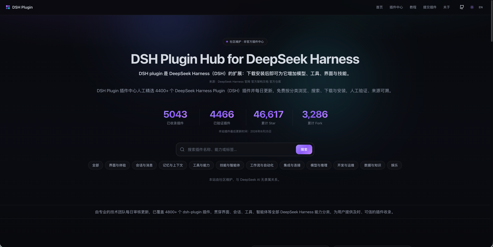
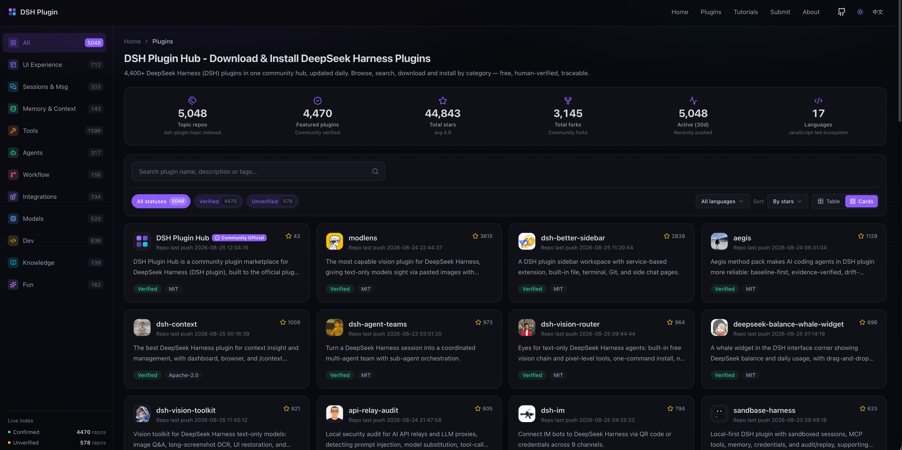

<div align="center">

<p>
  
</p>

# DSH Plugin 插件市场 - DeepSeek Harness Plugin (DSH) 下载与安装 · 插件大全

**DeepSeek Harness Plugin（DSH）插件市场与插件大全：主站收录 23,000+ 个插件，其中 6,000+ 个已发布 NPM 包、可在插件市场一键安装（均已人工精选验证）。每日更新，免费浏览、搜索并按分类发现、下载与安装 DSH 插件，来源可溯。**

[](LICENSE)
[](https://www.npmjs.com/package/dsh-plugin)
[](https://github.com/dshplugin/dsh-plugin-hub/actions)
[](https://dsh-plugin.org/plugins/dshplugin/dsh-plugin-hub)
[](https://github.com/dshplugin/dsh-plugin-hub)
[](https://dsh-plugin.org)
[](https://github.com/topics/dsh-plugin)

[官网](https://dsh-plugin.org) · [提交 Issue](https://github.com/dshplugin/dsh-plugin-hub/issues) · [提交插件](https://dsh-plugin.org/zh/submit)

**简体中文** · [English](README.en.md)

</div>

---

## 什么是 DSH Plugin Hub

DSH Plugin Hub 是 **DeepSeek Harness 社区插件市场**：一个遵循官方插件开发规范构建的开源插件，安装进「设置 → 插件市场」后，无需离开应用即可浏览、搜索并一键安装社区插件。官方网页版（`dsh web`）与官方桌面版都支持。本项目为独立社区项目，与 DeepSeek Harness 官方无隶属关系。

<p align="center">
  
</p>

## 插件市场特性

**一键操作 · 全部可视化**

- **一键安装** — 点击即装：后台队列串行执行，弹窗实时显示安装进度，可随时取消；装完即生效，只有插件市场自身等顶层 bundle 会提示重启
- **一键升级** — 目录检测到新版本自动提示，卡片按钮变为「更新」，覆盖安装一键完成
- **一键卸载** — 卸载全程可视化，实时进度一目了然，卸载成功即生效
- **任务留痕** — 每次安装 / 升级 / 卸载的成功与失败都会写入通知中心，随时回查

**通知中心**

- 进行中任务的实时进度与取消、待重启项、成功 / 失败历史记录集中管理
- 失败可一键提交 GitHub Issue，为开源做贡献；装完即生效，仅在刷新无法解决时才提示重启，且只给单个「立即重启」，关闭弹窗即视为稍后

**资源丰富 · 人工精选**

- 主站收录 **23,000+** 个社区插件，其中 **6,000+** 个已发布 NPM 包、可在插件市场一键安装；目录由 [dsh-plugin.org](https://dsh-plugin.org) 每日收录，可安装条目均经人工审核
- 涵盖界面与体验、会话与消息、记忆与上下文、工具能力等分类，按分类浏览、搜索直达
- 市场只展示核验通过（verified）的插件，卡片标注 Star / Fork 评分、版本号与最近更新时间，来源可溯

**中英双语 · 直观筛选**

- 界面默认跟随系统语言，右上角一键手动切换，界面文案与插件数据同步切换
- 支持按 Star / Fork / 最近更新 / 最新收录排序（点击切换正倒序），双语描述、能力标签一目了然
- 全文搜索覆盖名称、描述与能力标签，精确定位目标插件

**实时同步 · 轻量安全**

- 数据与官网同源，安装后自动获取最新目录，无需手动升级
- 插件自带宿主端服务：目录代理、安装队列、设置与日志都在本机执行，无遥测、无隐私采集

## 功能一览

**已安装插件列表 · 自定义安装**

<p align="center">
  
  
</p>

集中管理当前环境已装的全部插件，支持搜索、来源筛选与排序，行尾提供更新、卸载与「在 Finder 中显示」（Windows / Linux 为「在文件夹中显示」） · 手动安装目录外的插件：只接受 NPM 包名或 npm / pnpm 安装命令，不再提供 GitHub 源码与 git 安装

**设置 · 系统日志**

<p align="center">
  
  
</p>

集中配置更新检查、npm 镜像源与自动换源、HTTP 代理、NPM 安装开关、系统诊断与日志存放位置 · 记录安装、卸载、设置变更与诊断轨迹，按分类与级别筛选，内置日志查看器

**确认安装 · 确认卸载**

<p align="center">
  
  
</p>

安装前展示插件名称、来源仓库与执行命令，确认后才开始安装 · 卸载前展示待移除的插件，确认后才从环境移除，避免误删

**确认更新 · 通知中心**

<p align="center">
  
  
</p>

检测到新版本时弹出，确认后原位覆盖安装到最新版 · 集中管理安装、卸载、更新的历史记录、实时进度与待重启提醒

## 官网一览

插件市场的数据由 [dsh-plugin.org](https://dsh-plugin.org) 整理发布，两侧实时同步；在官网还可以查看插件详情、安装命令与 GitHub 源码链接。

**官网首页 · 分类展示**

<p align="center">
  
  
</p>

数据与插件市场同源，人工精选验证、每日更新 · 按分类浏览全部收录插件，支持搜索直达

## 为什么选择 DSH Plugin Hub

DSH Plugin 插件市场收录 **6,000+** 个可一键安装的 NPM 插件（主站共收录 **23,000+** 个 DSH 插件），均已人工精选验证，每日更新，免费按分类浏览、搜索、下载与安装，来源可溯。

### 及时更新

新发布的 DSH plugin 会尽快收录进插件市场，已有插件的描述、分类与兼容状态也会定期刷新。专业团队持续跟进 DeepSeek Harness 生态动态，让你始终看到最新信息。

### 人工审核

每个 DSH plugin 都由专业的技术团队人工核查，逐项核对安装命令、兼容性与 DSH 目标版本（dshTarget），并标注能力分类；只有核验通过的条目才会进入插件市场。

### 来源可查

每个 DSH plugin 都链回其 GitHub 源码仓库，并展示 Star、Fork 与最近更新时间；本站数据整理自 DeepSeek Harness 官网、官方架构文档与官方仓库，看到的信息都有据可查。

## 环境要求

- **DeepSeek Harness**：官方网页版（`dsh web`）或官方桌面版，安装后在「设置 → 插件市场」使用
- **Node.js >= 22.6**：插件按该版本声明（`engines`），宿主与命令行 `dsh` 均需满足
- **pnpm**：`dsh` 用 pnpm 管理 profile 插件，缺失时安装会被拦下，先执行 `npm install -g pnpm`
- **可用的 npm 源**：默认跟随本机 npm 配置；连不上时可在「设置 → 插件市场 → 更新设置」里换镜像、开启自动换源或填写 HTTP 代理

## 安装 DSH Plugin Hub

从 npm 安装：

```bash
dsh plugin --profile web add dsh-plugin
```

插件已发布到 npm registry（包名 `dsh-plugin`），一条命令即可安装使用，无需任何构建。该命令面向官方网页版（web profile）；官方桌面版直接在应用内「设置 → 插件市场」安装即可——桌面 profile 由应用独占管理，命令行的 `dsh` 无权写入。

> **只提供 npm 安装**：源码 / git 安装要依赖各仓库自己的构建脚本，写法不统一、失败率高（git 包常被 pnpm 的构建脚本限制直接拦下），装出来的行为也不一致，因此不再提供。插件已内置浏览器端 bundle，npm 安装无需构建；装完重启 `dsh web`，在「设置 → 插件市场」即可使用。

## 更新 DSH Plugin Hub

插件市场检测到新版本时会提示一键更新；如果旧版本存在更新缺陷导致拉取不到最新版，请直接用命令行升级：

**方式一：直接更新到最新（推荐）**

```bash
dsh plugin --profile web update dsh-plugin
```

**方式二：强制升级（旧版更新不上时）**

`update` 若受旧版缺陷影响无法拉取最新版，用显式版本号强制重装最新版：

```bash
dsh plugin --profile web add dsh-plugin@latest
```

**方式三：卸载重装到最新（最稳）**

`add` 对已安装的实例不覆盖版本，先卸载再安装必然拿到最新版：

```bash
dsh plugin --profile web remove dsh-plugin
dsh plugin --profile web add dsh-plugin
```

> 更新后重启 `dsh web` 即可生效。桌面版请在应用内的插件市场一键更新（桌面 profile 归应用管理，上面的命令行不适用）。

> **更新/重装后市场不见了？** 如果你在「设置 → 插件」里取消勾选过 `dsh-plugin`，profile 的 `dsh.profile.bundles` 里就没有它了——依赖还在 `node_modules`，但不会被组合，重启后市场不会出现。到「设置 → 插件」重新勾选 `dsh-plugin`；也可以把 `"dsh-plugin"` 加回 `~/.dsh/profiles/<profile>/package.json` 的 `dsh.profile.bundles`，再重启宿主。

## 卸载 DSH Plugin Hub

网页版：

```bash
dsh plugin --profile web remove dsh-plugin
```

桌面版：在应用内「设置 → 插件」里禁用或移除 `dsh-plugin`（桌面 profile 由应用独占管理，命令行不适用）。

卸载只移除插件市场本身，不影响已装好的其他插件；卸载后重启 `dsh web`，或退出并重新打开桌面应用。

## 快速开始：在 DeepSeek Harness 中使用

网页版安装后重启 `dsh web`，桌面版退出并重新打开应用；随后打开 **设置 → 插件市场**，即可浏览并安装插件。插件市场与 [dsh-plugin.org](https://dsh-plugin.org) 官网数据同源、实时同步。

## 故障排查

- **市场没出现，或更新后消失**：多半是之前在「设置 → 插件」取消勾选过 `dsh-plugin`，重新勾选即可，详见上方「更新/重装后市场不见了？」
- **连不上源 / 安装超时**：在「设置 → 插件市场 → 更新设置」里换 npm 镜像源、开启「连不上时自动换源」，或填写 HTTP 代理；「系统诊断」可一键检测 npm 源、GitHub 与目录站点的连通性
- **提示 npm 版本过低**：npm 解析依赖时内部崩溃是 npm 自身的已知缺陷，升级后重试：`npm install -g npm@latest`
- **提示缺少 pnpm**：先 `npm install -g pnpm`，确认已在 PATH 中再重试
- **装完没生效**：插件市场自身与顶层 bundle 需要重启宿主——网页版点「立即重启」，桌面版从应用菜单（或托盘）退出后重新打开
- **需要更细的线索**：「设置 → 插件市场 → 系统日志」可按分类 / 级别筛选并导出全文；提交 Issue 时附上日志能更快定位

## 提交你的 DSH plugin

将你的插件发布到 GitHub 并添加 `dsh-plugin` topic，即可被 DSH Plugin 插件目录自动发现与收录。收录要求与提交流程见官网[提交插件](https://dsh-plugin.org/zh/submit)页面。

## 参与开发

本仓库是完整源码，可本地构建、测试与调试：

```bash
npm ci
npm run check    # typecheck + test + build
npm run reload   # 重启本机宿主，加载新的客户端 bundle
```

开发需 Node.js >= 22.6（`npm test` 依赖原生 type stripping）。分层与目录结构见 [docs/architecture.md](docs/architecture.md)，日常开发流程与发布见 [docs/development.md](docs/development.md)，提交规范与 PR 流程见 [CONTRIBUTING.md](CONTRIBUTING.md)。

## 贡献

- **收录你的插件**：添加 `dsh-plugin` topic 即可被自动发现，入口见官网[提交插件](https://dsh-plugin.org/zh/submit)
- **数据勘误 / 功能建议**：欢迎[提交 Issue](https://github.com/dshplugin/dsh-plugin-hub/issues)
- **参与开发**：Fork 本仓库并提交 Pull Request，动手前请读 [CONTRIBUTING.md](CONTRIBUTING.md)
- **安全问题**：请勿公开提交 Issue，按 [SECURITY.md](SECURITY.md) 私下报告
- **更新日志**：每个版本的变更见 [docs/releases](docs/releases) 与 GitHub [Releases](https://github.com/dshplugin/dsh-plugin-hub/releases)

本项目遵循[贡献者行为准则](CODE_OF_CONDUCT.md)。

## 相关项目

- [dsh-plugin.org](https://dsh-plugin.org) — 插件市场官网，数据同源
- [deepseek-ai/deepseek-harness](https://github.com/deepseek-ai/deepseek-harness) — DeepSeek Harness 本体

## 许可

[MIT](LICENSE) © DSH Plugin Hub contributors
